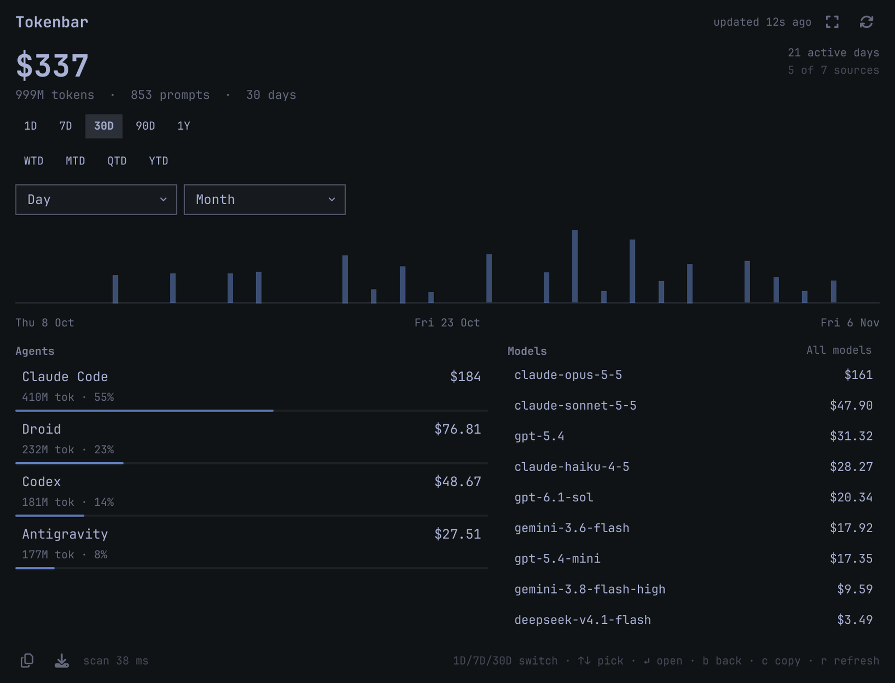

<p align="center">
  
</p>

# Tokenbar

Token usage and estimated cost for every coding agent on the machine, in the
Omarchy bar.

The bar shows one number: what today cost. Click it and the dashboard opens
with the same data Tokenbar's desktop app shows — ranges, a daily chart, a
breakdown per agent and per model, and a detail view for any agent you pick.
Nothing is uploaded and nothing is scraped: the plugin reads the session logs
the agents already write to disk.

## Install

```bash
omarchy plugin add https://github.com/isHeSatoshi/omarchy-tokenbar.git --enable
```

Then pick a spot in the bar. `--enable` places it where the manifest asks
(the right section, beside the tray); to move it:

```bash
omarchy bar move io.github.ishesatoshi.tokenbar --before omarchy.monitor
```

## What it reads

Every source is a local file. If a tool has never run on the machine, its
source is skipped and the panel's source count stays honest about it.

| Agent | Path |
| --- | --- |
| Droid | `~/.factory/logs/droid-log-single.log*`, `~/.factory/sessions/**` |
| Antigravity | `~/.gemini/antigravity-cli/brain/**` |
| Claude Code | `~/.claude/projects/**/*.jsonl` |
| Codex | `~/.codex/sessions/**/*.jsonl` |
| OpenCode | `~/.local/share/opencode/opencode.db` |
| Gemini CLI | `~/.gemini/tmp/**/chats/session-*.json` |
| Anything Omarchy tracks | `~/.local/state/omarchy/agents/usage/*.json` |

The Omarchy records are the fallback: an agent with its own parser here is not
counted twice, and one without a parser still shows up through what Omarchy
recorded for it.

## How cost is estimated

Token counts are read from each agent's own logs. Cost is those counts times a
built-in price table per million tokens, split into input, output, cache read
and cache write, the same way `ccusage` prices a session. Models the table does
not know are still counted in the token totals and listed at the bottom of the
panel as unpriced, so a missing price never silently changes the token number.

The price table lives in `bin/tokenbar-scan` as `PRICES`, one regex per model
family, and was checked against LiteLLM's published per-model prices. Prices
change; the table is a snapshot and the totals are an estimate, not a bill.

## Settings

Each setting is a key on the widget in `~/.config/omarchy/shell.json`:

| Key | Values | Default | Meaning |
| --- | --- | --- | --- |
| `display` | `cost`, `tokens`, `both` | `cost` | What the bar readout shows |
| `range` | `today`, `7d`, `30d` | `today` | Window the bar readout covers |
| `refreshSec` | 30–3600 | `120` | How often the scanner checks for appended log lines |
| `showIcon` | `true`, `false` | `true` | Draw the chart glyph beside the value |

```bash
omarchy bar set io.github.ishesatoshi.tokenbar display both
omarchy bar set io.github.ishesatoshi.tokenbar range 7d
```

Clicking with the middle button cycles `display` without opening a file, and
the right button forces a rescan.

## The panel

- **Ranges**: 1D, 7D, 30D, 90D, 1Y, plus week/month/quarter/year to date.
- **Calendar**: pick any day or any month the logs cover, or click a bar in the
  chart to drill into it.
- **Agents**: rows with their share of the range's spend. Click one for its
  own cost, cost per million tokens, cache hit rate, cost per active day,
  sessions, prompts, chart, and models.
- **Models**: the top models in range, or the full list behind *All models*.
- **Wide**: the corners button spreads agents and models side by side.
- **Copy summary** puts a plain-text digest on the clipboard; **Save card**
  writes a 2400×1350 share image to `~/Pictures/Tokenbar`.

Before any agent has written a session, the panel says so instead of drawing an
empty chart, and the bar reads `—` rather than a misleading `$0.00`.

Keys while the panel is open: `1`/`7`/`3` pick a range, `↑`/`↓` move, `Enter`
opens an agent, `b` goes back, `r` rescans, `c` copies the summary, `Esc`
closes.

## Why it is fast

The scanner is one Python file with no imports outside the standard library.
It remembers a byte offset per file in `~/.cache/omarchy/tokenbar/scan-state.json`
and reads only the bytes appended since the last run, extracting fields with
regexes instead of parsing megabyte-long JSON lines. A run where nothing has
changed is a handful of `stat` calls.

Measured on a machine with 25 log files: **~48 ms end to end** for an unchanged
scan (including the Python interpreter start), **~100 ms** for a full rescan
that re-reads every file from the beginning. The cache is written atomically,
and a lock keeps two refreshes from scanning at once.

## Requirements

- Python 3.11 or newer (stdlib only; no pip packages)
- Quickshell, which Omarchy already runs

Optional: `rsvg-convert`, `inkscape`, or ImageMagick to save the share card as
PNG (the SVG is always written), and `wl-clipboard` for *Copy summary*.

## Privacy

The plugin opens the log files above read-only, keeps a byte-offset cache under
`~/.cache/omarchy/tokenbar/`, and makes no network requests. Nothing leaves the
machine: there is no telemetry, no account, and no API key.

## Removal

```bash
omarchy plugin remove io.github.ishesatoshi.tokenbar
```

That disables the widget and deletes `~/.config/omarchy/plugins/io.github.ishesatoshi.tokenbar`.
The cache in `~/.cache/omarchy/tokenbar/` is left alone; delete it too if you
want the state gone.

## Development

```bash
cd ~/.config/omarchy/plugins/io.github.ishesatoshi.tokenbar
python3 -m unittest discover -s tests -q   # scanner, 17 cases
node tests/model.test.mjs                  # range maths and formatting, 15 cases
python3 tests/make-demo.py                 # deterministic synthetic payload
```

`tests/preview.qml` draws the panel offscreen from that synthetic payload and
writes `/tmp/preview-*.png`, so layout can be checked without a live bar and
without a screenshot of anyone's real usage:

```bash
mkdir -p /tmp/tb-preview && cp *.qml *.js tests/preview.qml tests/demo-payload.json /tmp/tb-preview/
ln -s /usr/share/omarchy/shell/Commons /usr/share/omarchy/shell/Ui /tmp/tb-preview/
OMARCHY_PATH=/usr/share/omarchy QT_QPA_PLATFORM=offscreen quickshell -p /tmp/tb-preview/preview.qml
```

## License

MIT. See [LICENSE](LICENSE).
